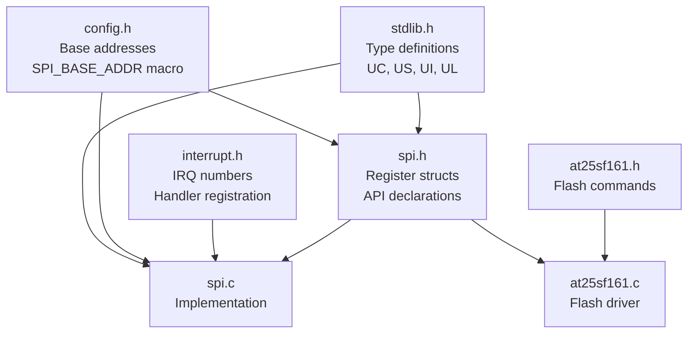

# VEGA THEJAS32 SPI BSP Structure Analysis

**Project:** Lattice Flight Controller (THEJAS32 / RV32IM)
**Date:** 2026-11-03
**Stage:** 1 — BSP Structure Understanding
**Status:** Complete

---

## 1. Source/Header Inventory

| File          | Path                                                                                                                                 | Purpose                                                               |
| ------------- | ------------------------------------------------------------------------------------------------------------------------------------ | --------------------------------------------------------------------- |
| `spi.h`       | `freertos-thejas32/Demo/RISCV_CDAC_THEJAS32/thejas32_hal/drivers/vega-sdk_freertos_thejas32/bsp/include/spi.h`                       | SPI register definitions, control structures, public API declarations |
| `spi.c`       | `freertos-thejas32/Demo/RISCV_CDAC_THEJAS32/thejas32_hal/drivers/vega-sdk_freertos_thejas32/bsp/drivers/spi/spi.c`                   | SPI driver implementation                                             |
| `config.h`    | `freertos-thejas32/Demo/RISCV_CDAC_THEJAS32/thejas32_hal/drivers/vega-sdk_freertos_thejas32/bsp/include/config.h`                    | Base addresses, system frequency, peripheral memory map               |
| `interrupt.h` | `freertos-thejas32/Demo/RISCV_CDAC_THEJAS32/thejas32_hal/drivers/vega-sdk_freertos_thejas32/bsp/include/interrupt.h`                 | Interrupt controller register map, IRQ numbers, handler registration  |
| `stdlib.h`    | `freertos-thejas32/Demo/RISCV_CDAC_THEJAS32/thejas32_hal/drivers/vega-sdk_freertos_thejas32/bsp/include/stdlib.h`                    | Type definitions (UC, US, UI, UL), standard library functions         |
| `at25sf161.h` | `freertos-thejas32/Demo/RISCV_CDAC_THEJAS32/thejas32_hal/drivers/vega-sdk_freertos_thejas32/bsp/include/at25sf161.h`                 | Example SPI flash driver header (AT25SF161)                           |
| `at25sf161.c` | `freertos-thejas32/Demo/RISCV_CDAC_THEJAS32/thejas32_hal/drivers/vega-sdk_freertos_thejas32/bsp/drivers/at25sf161_flash/at25sf161.c` | Example SPI flash driver implementation (freertos-thejas32 copy)      |

### Additional Examples from `~/vega-sdk/examples/spi/`

| Example Directory | Device | Key Files |
|-------------------|--------|-----------|
| `at25sf161_spi_eeprom/` | AT25SF161 Flash | `at25sf161.c/h`, `at25sf161_demo.c` |
| `w25q32_spi_flash/` | W25Q32 Flash | `w25q32.c/h` |
| `nrf24l01/nrf24l01_radio_rx_demo/` | nRF24L01 Radio | `nrf24.c/h`, `nRF24L01.h` |
| `rc522_rfid_demo/` | RC522 RFID | `rc522_rfid_demo.c`, `mfrc522.h` |
| `dfrobot_ili9488_spi_display/` | ILI9488 Display | (TFT LCD) |
| `ssd1309_transparent_oled_demo/` | SSD1309 OLED | (OLED display) |
| `led_dot_matrix_demo/` | MAX7219 | (LED matrix) |
| `sd-card/` | SD Card | (SPI mode) |
| `sst25vf040b_spi_eeprom/` | SST25VF040B Flash | (SPI EEPROM) |

---

## 2. Dependency Tree



**Key Observations:**
- `spi.h` is the central public header — all SPI users include this
- `config.h` provides `SPI_BASE_ADDR(i)` macro that computes base address per instance
- `interrupt.h` is only needed for interrupt-driven operation (`spi_register_isr`)
- The example flash driver (`at25sf161.c`) uses only polling-mode APIs

---

## 3. SPI Instances and Memory Map

From `config.h:26`:
```c
#define SPI_BASE_ADDR(i)   (((i) == 0 || (i) == 1) ? 0x10000600UL : 0x10200100UL)
```

| SPI Instance | Base Address | Register Stride |
|--------------|--------------|-----------------|
| SPI 0 (MDP_SPI_0) | 0x10000600 | 0x100 |
| SPI 1 (MDP_SPI_1) | 0x10000700 | 0x100 |
| SPI 2 (MDP_SPI_2) | 0x10200100 | 0x100 |
| SPI 3 (MDP_SPI_3) | 0x10200200 | 0x100 |

From `spi.h:135`:
```c
#define SPIreg(i) (*((volatile SPIregType *)(SPI_BASE_ADDR(i) + (0x100 * (i % 2)))))
```

**Note:** The register stride is 0x100 (256 bytes) per instance. SPI 0/1 share one base region, SPI 2/3 share another. The modulo-2 indexing means SPI 0 and 2 map to offset 0, SPI 1 and 3 map to offset 0x100 within their respective base regions.

---

## 4. Register Structure (`SPIregType`)

Defined in `spi.h:111-124`:

```c
typedef struct {
    union {
        struct {
            US PeriphCS :2, Periph :1, DataOrder :1, Mode :2, SPIrxTxIntr :2,
                    CSAAT :1, Dbits :4, Reserved :3;
        }__attribute__((packed)) Bits;
        US hword;
    } Control;              // Offset 0x00
    UI Status;              // Offset 0x04
    UI Baudrate;            // Offset 0x08
    UI TxData;              // Offset 0x0C
    UI RxData;              // Offset 0x10
} SPIregType;
```

**Register Map:**
| Offset | Register | Size | Description |
|--------|----------|------|-------------|
| 0x00 | Control | 16-bit | Mode, chip select, bit order, interrupts, data width, CSAAT |
| 0x04 | Status | 32-bit | Busy, overrun, RX complete, TX hold empty, interrupt status |
| 0x08 | Baudrate | 32-bit | Clock divider (value << 4) |
| 0x0C | TxData | 32-bit | Transmit data register (also holds slave select in bits 16-17) |
| 0x10 | RxData | 32-bit | Receive data register (also holds slave select in bits 16-17) |

---

## 5. Control Register Bit Fields (`SPIcntrlRegType`)

Defined in `spi.h:126-132` and documented in `spi.c:75-99`:

| Bits | Field | Description |
|------|-------|-------------|
| 15:13 | Reserved | Read/Write, should be 0 |
| 12:9 | DBITS | Data bits per transfer (0 = 8-bit, only value seen in BSP) |
| 8 | CSAAT | Chip Select Active After Transfer (1 = keep CS low after transfer) |
| 7 | SPTIE | SPI Transmit Interrupt Enable (1 = enabled) |
| 6 | SPI Receive Interrupt Enable | (1 = enabled) |
| 5 | CPOL | Clock Polarity |
| 4 | CPHA | Clock Phase |
| 3 | LSB/MSB First | 0 = MSB first, 1 = LSB first |
| 2 | PS | Peripheral Select: 0 = Fixed peripheral, 1 = Variable peripheral |
| 1:0 | PCS1:PCS0 | Peripheral Chip Select (active only if PS=1) |

**SPI Mode Encoding (CPOL/CPHA):**
| Mode | CPOL (bit 5) | CPHA (bit 4) |
|------|--------------|--------------|
| 0 | 0 | 0 |
| 1 | 0 | 1 |
| 2 | 1 | 0 |
| 3 | 1 | 1 |

**Chip Select Encoding (when PS=1):**
| PCS1 | PCS0 | CS Lines |
|------|------|----------|
| 0 | 0 | 1110 (CS0 active) |
| 0 | 1 | 1101 (CS1 active) |
| 1 | 0 | 1011 (CS2 active) |
| 1 | 1 | 0111 (CS3 active) |

---

## 6. Status Register Bit Definitions

From `spi.h:90-99`:

| Macro | Bit | Description |
|-------|-----|-------------|
| `SPI_BUSY_BIT` | 4 | SPI controller busy |
| `SPI_OVERR_BIT` | 5 | Overrun error |
| `SPI_RX_COMPLETE_BIT` | 6 | Receive complete |
| `SPI_TX_HOLD_EMPTY_BIT` | 7 | TX hold register empty |
| `SPI_RX_INT_STATUS_BIT` | 2 | RX interrupt status |
| `SPI_TX_INT_STATUS_BIT` | 3 | TX interrupt status |

---

## 7. Public API Entry Points

| Function                                                     | File:Line   | Purpose                                                                                         |
| ------------------------------------------------------------ | ----------- | ----------------------------------------------------------------------------------------------- |
| `SPI_init(UC spi_number)`                                    | `spi.c:49`  | Initialize with defaults (8-bit, Mode 3, MSB, fixed peripheral, CS0, 16-divider, no interrupts) |
| `SPI_config(UC spi_number, SPIcntrlRegType spi_control_reg)` | `spi.c:137` | Write full control register                                                                     |
| `SPI_set_baud(UC spi_number, UC bBaudCFD)`                   | `spi.c:168` | Set baud divider (0=4, 1=8, 2=16, ..., 9=2048)                                                  |
| `SPI_get_slave_select(UC spi_number)`                        | `spi.c:182` | Read slave select from RxData bits 16-17                                                        |
| `SPI_set_slave_select(UC spi_number, UI slave_sel_val)`      | `spi.c:198` | Write slave select to TxData bits 16-17                                                         |
| `SPI_check_overrun(UC spi_number)`                           | `spi.c:214` | Check overrun bit in Status                                                                     |
| `SPI_set_intr(UC spi_number, UC tx_intr, UC rx_intr)`        | `spi.c:233` | Enable/disable TX/RX interrupts                                                                 |
| `SPI_receive(UC spi_number)`                                 | `spi.c:253` | Blocking receive (waits for RX_COMPLETE)                                                        |
| `SPI_transmit(UC spi_number, US bData)`                      | `spi.c:271` | Blocking transmit (waits for not busy, then TX_HOLD_EMPTY)                                      |
| `SPI_wait_if_busy(UC spi_number)`                            | `spi.c:294` | Poll BUSY bit until clear                                                                       |
| `SPI_set_CSAAT_pin(UC spi_number, UC status)`                | `spi.c:311` | Set/clear CSAAT bit in Control                                                                  |
| `SPI_read_rx_reg(UC spi_number)`                             | `spi.c:328` | Direct RX register read (no wait)                                                               |
| `SPI_write_tx_reg(UC spi_number, US bData)`                  | `spi.c:342` | Direct TX register write (with busy/empty wait)                                                 |
| `spi_intr_status(UC spi_number)`                             | `spi.c:390` | Read interrupt status (RX or TX)                                                                |
| `spi_register_isr(UC spi_number, void (*spi_isr)())`         | `spi.c:360` | Register interrupt handler (maps SPI to IRQ)                                                    |

---

## 8. Baud Rate Divider Values

From `spi.h:79-88` and `spi.c:148-162`:

| Macro | Value | Divider |
|-------|-------|---------|
| `SPI_BAUD_CFD_4` | 0 | ÷4 |
| `SPI_BAUD_CFD_8` | 1 | ÷8 |
| `SPI_BAUD_CFD_16` | 2 | ÷16 |
| `SPI_BAUD_CFD_32` | 3 | ÷32 |
| `SPI_BAUD_CFD_64` | 4 | ÷64 |
| `SPI_BAUD_CFD_128` | 5 | ÷128 |
| `SPI_BAUD_CFD_256` | 6 | ÷256 |
| `SPI_BAUD_CFD_512` | 7 | ÷512 |
| `SPI_BAUD_CFD_1024` | 8 | ÷1024 |
| `SPI_BAUD_CFD_2048` | 9 | ÷2048 |

**Note:** The value is shifted left by 4 when written to Baudrate register (`spi.c:170`).

---

## 9. Example Application Usage (from BSP and vega-sdk)

### 9.1 AT25SF161 Flash (freertos-thejas32 & vega-sdk)

From `at25sf161.c` (both copies identical):

**Initialization Sequence:**
```c
SPIcntrlRegType at25sf161SpiCtrl;
at25sf161SpiCtrl.Bits.PeriphChipSelect = 0;
at25sf161SpiCtrl.Bits.PeriphType = 0;        // Fixed peripheral
at25sf161SpiCtrl.Bits.DataOrder = MSB;       // MSB first
at25sf161SpiCtrl.Bits.Mode = 3;              // SPI Mode 3 (CPOL=1, CPHA=1)
at25sf161SpiCtrl.Bits.SPIrxTxIntr = RX_TX_INTR_DIS;  // No interrupts
at25sf161SpiCtrl.Bits.CSAAT = LOW;
at25sf161SpiCtrl.Bits.Dbits = 0;             // 8-bit

currentSpi = spiNo;
SPI_init(currentSpi);
SPI_config(currentSpi, at25sf161SpiCtrl);
SPI_set_baud(currentSpi, SPI_BAUD_CFD_4);    // Fastest (÷4 = 25 MHz @ 100 MHz)
```

**Transaction Pattern (Read):**
```c
SPI_wait_if_busy(currentSpi);
SPI_set_CSAAT_pin(currentSpi, HIGH);   // Assert CS (keep low)
// Transmit command + address bytes
SPI_transmit(currentSpi, cmdBuf[0]);
SPI_transmit(currentSpi, cmdBuf[1]);
SPI_transmit(currentSpi, cmdBuf[2]);
SPI_transmit(currentSpi, cmdBuf[3]);
// Read data (transmit dummy, receive actual)
while (length) {
    SPI_transmit(currentSpi, DUMMY_DATA);
    *readBuf = SPI_receive(currentSpi);
    readBuf++; length--;
}
SPI_set_CSAAT_pin(currentSpi, LOW);    // Deassert CS
```

### 9.2 W25Q32 Flash (vega-sdk/examples/spi/w25q32_spi_flash/)

**Configuration:** Identical to AT25SF161 — Mode 3, ÷4 baud, CSAAT for multi-byte
**Difference:** Uses `PAGE_PROGRAM` (0x02) for writes, different erase commands

### 9.3 nRF24L01 Radio (vega-sdk/examples/spi/nrf24l01/)

**Configuration:**
```c
SPIcntrlRegType nrf24l01SpiCtrl;
nrf24l01SpiCtrl.Bits.Mode = 0;                     // SPI Mode 0
nrf24l01SpiCtrl.Bits.SPIrxTxIntr = RX_TX_INTR_DIS;
nrf24l01SpiCtrl.Bits.CSAAT = LOW;
nrf24l01SpiCtrl.Bits.Dbits = 0;
SPI_set_baud(currentSpi, SPI_BAUD_CFD_8);  // ÷8 = 12.5 MHz
```

**Key Patterns:**
- **CE pin controlled via separate GPIO** (not SPI CS)
- **Full-duplex helper:** `nrf24_transferSync(tx, rx, len)` loops `SPI_transmit` + `SPI_receive`
- **Register R/W:** CSAAT=HIGH → TX cmd → TX/RX data → CSAAT=LOW (per register)

### 9.4 RC522 RFID (vega-sdk/examples/spi/rc522_rfid_demo/)

**Configuration:**
```c
SPIcntrlRegType mfrc522SpiCtrl;
mfrc522SpiCtrl.Bits.Mode = 0;                      // SPI Mode 0
mfrc522SpiCtrl.Bits.SPIrxTxIntr = RX_TX_INTR_DIS;
mfrc522SpiCtrl.Bits.CSAAT = LOW;
mfrc522SpiCtrl.Bits.Dbits = 0;
SPI_set_baud(currentSpi, SPI_BAUD_CFD_32); // ÷32 = 3.125 MHz
```

**Key Patterns:**
- **Slow baud rate** (÷32) for reliability
- **Register R/W:** 2-byte transactions (cmd + data) with CSAAT per register
- **Command format:** `((reg << 1) & 0x7E)` for write, `| 0x80` for read

### 9.5 Summary of Device Configurations

| Device | SPI Mode | Baud Divider | Speed @ 100 MHz | CSAAT Usage | Notes |
|--------|----------|--------------|-----------------|-------------|-------|
| AT25SF161 Flash | 3 | ÷4 (CFD_4) | 25 MHz | Multi-byte (cmd+addr+data) | Fast, CS held for entire transaction |
| W25Q32 Flash | 3 | ÷4 (CFD_4) | 25 MHz | Multi-byte | Same as AT25SF161 |
| nRF24L01 Radio | 0 | ÷8 (CFD_8) | 12.5 MHz | Per register (2-5 bytes) | Separate CE GPIO |
| RC522 RFID | 0 | ÷32 (CFD_32) | 3.125 MHz | Per register (2 bytes) | Slow, command+data per access |
| ILI9488 Display | 0/3 | ÷4-÷8 | 12.5-25 MHz | Multi-byte | TFT LCD, command+data |
| SSD1309 OLED | 0/3 | ÷4-÷8 | 12.5-25 MHz | Multi-byte | OLED display |
| MAX7219 Matrix | 0 | ÷8-÷16 | 6.25-12.5 MHz | Multi-byte | LED matrix driver |

**Key Observations from All Examples:**
- Uses **polling mode only** — no interrupts demonstrated in any example
- Manual chip select management via `CSAAT` bit
- Full-duplex simulated by alternating transmit dummy / receive data
- 8-bit transfers only (Dbits=0)
- No DMA usage shown
- **SPI Mode 0** for most peripherals (nRF24, RC522, displays), **Mode 3** for flash
- **Baud rate varies** by device tolerance (3-25 MHz)

---

## 10. Interrupt Mapping

From `spi.c:360-381` and `interrupt.h`:

| SPI Instance | RV32 IRQ | RV64 IRQ |
|--------------|----------|----------|
| SPI 0 | 3 | 6 |
| SPI 1 | 4 | 7 |
| SPI 2 | 23 | 52 |
| SPI 3 | — | 53 |

**Note:** RV32 only defines IRQs for SPI 0, 1, 2. SPI 3 interrupt only available on RV64.

---

## 11. Type Definitions (from `stdlib.h`)

| Type | Size | C Equivalent |
|------|------|--------------|
| `UC` | 1 byte | `unsigned char` |
| `US` | 2 bytes | `unsigned short` |
| `UI` | 4 bytes | `unsigned int` |
| `UL` | 4 bytes | `unsigned long` |

**Note:** On RV32, `UI` and `UL` are both 32-bit. On RV64, `UL` becomes 64-bit.

---

## 12. Verified vs. Unverified Capabilities

| Capability | Verified in BSP? | Verified in Examples? | Notes |
|------------|------------------|----------------------|-------|
| 4 SPI instances | Yes | SPI 0 primarily | Register map supports 4, but RV32 IRQs only for 0-2; user confirms 3 physical ports |
| Master mode | Yes | Yes | Only mode demonstrated across all examples |
| Slave mode | No | No | No API or example for slave operation |
| Polling mode | Yes | Yes | All examples use polling exclusively |
| Interrupt mode | Partially | No | API exists (`spi_register_isr`, `SPI_set_intr`), **no example usage** |
| DMA mode | No | No | No DMA APIs in SPI driver |
| Multiple chip selects | Yes | No | 4 CS lines via PCS bits (when PS=1), but all examples use fixed CS0 |
| Variable peripheral mode | Yes | No | PS bit supports it, but all examples use fixed peripheral (PS=0) |
| Configurable data width | Partially | No | DBITS field exists, but only 8-bit (value 0) used everywhere |
| SPI Modes 0-3 | Yes | Modes 0 & 3 | Mode field supports all 4; Mode 0 for radios/displays, Mode 3 for flash |
| MSB/LSB first | Yes | MSB only | DataOrder bit, all examples use MSB |
| CSAAT (hold CS) | Yes | Yes | Dedicated bit, **critical for all multi-byte transactions** |
| Full-duplex | Partially | Yes (simulated) | Hardware supports it (separate TX/RX registers), API is half-duplex; examples simulate full-duplex via TX dummy + RX |
| Baud rate ÷4–÷2048 | Yes | ÷4, ÷8, ÷32 | 10 divider values available; examples use ÷4 (flash), ÷8 (radio), ÷32 (RFID) |
| 3 physical SPI ports | — | User confirmed | Board has 3 SPI ports physically accessible |

---

## 13. Open Questions

1. **What is the system clock frequency for SPI baud calculation?** `SYSTEM_FREQUENCY` is 100 MHz in `config.h`, but is this the SPI peripheral clock?
2. **Does the hardware support slave mode?** Register map has no obvious slave-specific bits.
3. **What is the FIFO depth?** Status register has TX_HOLD_EMPTY and RX_COMPLETE but no FIFO level indicators.
4. **Are SPI 2/3 fully functional on RV32?** IRQ mapping only goes to SPI 2.
5. **What does "Fixed peripheral" vs "Variable peripheral" mean electrically?** Fixed appears to use dedicated CS0, Variable uses PCS bits.
6. **Is there hardware flow control or automatic CS deassertion?** CSAAT bit suggests manual control only.

---

## 14. Files Referenced

| File | Key Lines |
|------|-----------|
| `spi.h` | 33-36 (instances), 111-124 (SPIregType), 126-132 (SPIcntrlRegType), 135 (SPIreg macro), 146-161 (API declarations) |
| `spi.c` | 49-69 (SPI_init), 137-144 (SPI_config), 168-173 (SPI_set_baud), 214-222 (SPI_check_overrun), 233-244 (SPI_set_intr), 253-261 (SPI_receive), 271-280 (SPI_transmit), 294-300 (SPI_wait_if_busy), 311-319 (SPI_set_CSAAT_pin), 360-381 (spi_register_isr), 390-410 (spi_intr_status) |
| `config.h` | 26 (SPI_BASE_ADDR) |
| `interrupt.h` | 68-70, 43-44 (IRQ mapping) |
| `at25sf161.c` (freertos) | 43-64 (init), 73-102 (read), 112-147 (write) |
| `at25sf161.c` (vega-sdk) | Identical to freertos copy |
| `w25q32.c` (vega-sdk) | 43-66 (init), 75-103 (read), 113-151 (write) |
| `nrf24.c` (vega-sdk) | 18-37 (init), 145-161 (getData), 174-208 (send), 289-312 (transferSync), 315-348 (register R/W) |
| `rc522_rfid_demo.c` (vega-sdk) | 30-68 (init), 70-92 (register R/W), 99-229 (card communication) |

---

## 15. Next Steps (Stage 2)

Proceed to hardware register-level analysis:
1. Decode each register bit field with hardware behavior
2. Understand clock generation and baud rate derivation
3. Analyze SPI transaction timing (CPOL/CPHA electrical behavior)
4. Investigate chip select generation mechanism
5. Determine FIFO/buffer architecture from register behavior

---
*Document generated as part of Stage 1 BSP Structure Analysis for Lattice SPI HAL development.*