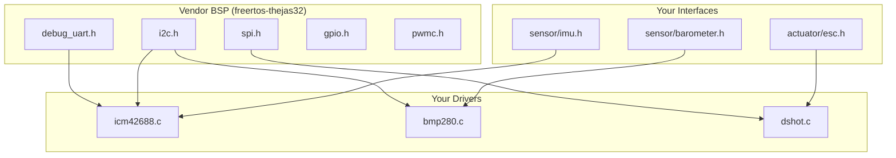

# Architecture Details

---
tags: [architecture, layers, interfaces]
status: active
created: 2026-11-01
---

# Architecture Details

> Detailed specification for each layer in the flight controller stack.

## Layer Diagram



## Layer 1: interfaces/ — Abstract Contracts

**Purpose:** Define what each hardware component can do, independent of implementation.

**Rule:** Never change these once drivers depend on them.

### IMU Interface (`interfaces/sensor/imu.h`)

```c
#pragma once
#include <stdint.h>
#include <stdbool.h>

typedef struct {
    float accel[3];        // m/s²
    float gyro[3];         // rad/s
    float temp;            // °C
    uint32_t timestamp_ms; // monotonic
} imu_data_t;

typedef struct {
    bool (*init)(void);
    bool (*read)(imu_data_t *out);
    bool (*self_test)(void);
    const char *name;
} imu_driver_t;

extern const imu_driver_t *imu;
```

### Barometer Interface (`interfaces/sensor/barometer.h`)

```c
#pragma once
#include <stdint.h>
#include <stdbool.h>

typedef struct {
    float pressure_pa;
    float temperature_c;
    float altitude_m;
    uint32_t timestamp_ms;
} baro_data_t;

typedef struct {
    bool (*init)(void);
    bool (*read)(baro_data_t *out);
    const char *name;
} baro_driver_t;

extern const baro_driver_t *baro;
```

### ESC Interface (`interfaces/actuator/esc.h`)

```c
#pragma once
#include <stdint.h>
#include <stdbool.h>

typedef struct {
    uint16_t motor[4]; // PWM µs, 1000-2000
    bool armed;
} esc_cmd_t;

typedef struct {
    bool (*init)(void);
    bool (*write)(const esc_cmd_t *cmd);
    bool (*arm)(void);
    bool (*disarm)(void);
    const char *name;
} esc_driver_t;

extern const esc_driver_t *esc;
```

## Layer 2: devices/ — Concrete Drivers

**Purpose:** Implement `interfaces/` using vendor BSP headers from `freertos-thejas32`.

**Rule:** Include vendor headers directly. One driver per sensor/actuator.

### ICM-42688 Driver (`devices/sensors/imu/icm42688.c`)

```c
#include "interfaces/sensor/imu.h"
#include "i2c.h"           // VENDOR BSP header
#include "debug_uart.h"

#define ICM_ADDR 0x68
#define REG_WHO_AM_I 0x75
#define REG_PWR_MGMT_1 0x6B

static bool icm_init(void) {
    uint8_t whoami;
    if (i2c_read_reg(I2C_0, ICM_ADDR, REG_WHO_AM_I, &whoami) != 0) return false;
    if (whoami != 0x47) return false;
    return i2c_write_reg(I2C_0, ICM_ADDR, REG_PWR_MGMT_1, 0x01) == 0;
}

static bool icm_read(imu_data_t *d) {
    uint8_t buf[12];
    if (i2c_read_burst(I2C_0, ICM_ADDR, 0x3B, buf, 12) != 0) return false;
    d->accel[0] = (int16_t)((buf[0]<<8)|buf[1]) / 16384.0f * 9.81f;
    d->accel[1] = (int16_t)((buf[2]<<8)|buf[3]) / 16384.0f * 9.81f;
    d->accel[2] = (int16_t)((buf[4]<<8)|buf[5]) / 16384.0f * 9.81f;
    d->gyro[0]  = (int16_t)((buf[8]<<8)|buf[9])  / 131.0f;
    d->gyro[1]  = (int16_t)((buf[10]<<8)|buf[11]) / 131.0f;
    d->temp = 25.0f;
    d->timestamp_ms = xTaskGetTickCount();
    return true;
}

static bool icm_self_test(void) { return true; }

const imu_driver_t icm42688_driver = {
    .init = icm_init,
    .read = icm_read,
    .self_test = icm_self_test,
    .name = "ICM-42688"
};
```

### Driver Registration (`config/sensors.c`)

```c
#include "interfaces/sensor/imu.h"
#include "devices/sensors/imu/icm42688.c"

const imu_driver_t *imu = &icm42688_driver;
```

## Layer 3: core/ — Pure Algorithms

**Purpose:** Flight math with **zero hardware dependencies.**

**Rule:** No vendor headers. No FreeRTOS includes. Compiles on Linux with `gcc`.

### EKF (`core/estimation/ekf.h`)

```c
#pragma once
#include <stdint.h>

typedef struct {
    float roll, pitch, yaw;
    float bias[3];
    float P[9]; // covariance
} ekf_state_t;

typedef struct {
    float accel[3];
    float gyro[3];
} imu_sample_t;

void ekf_init(ekf_state_t *s);
void ekf_predict(ekf_state_t *s, const imu_sample_t *imu, float dt);
void ekf_update_accel(ekf_state_t *s, const float accel[3]);
```

### PID (`core/control/pid.h`)

```c
#pragma once
#include <stdint.h>

typedef struct {
    float kp, ki, kd;
    float integral, prev_error;
    float output_min, output_max;
} pid_t;

void pid_init(pid_t *p, float kp, float ki, float kd);
float pid_update(pid_t *p, float error, float dt);
void pid_reset(pid_t *p);
```

## Layer 4: app/ — Flight Logic

**Purpose:** Wire sensors → algorithms → actuators.

**Rule:** Include `interfaces/` and `core/`. No vendor headers.

### Attitude Task (`app/flight/attitude.c`)

```c
#include "interfaces/sensor/imu.h"
#include "interfaces/actuator/esc.h"
#include "core/control/pid.h"
#include "FreeRTOS.h"
#include "task.h"

static pid_t roll_pid, pitch_pid, yaw_pid;

void attitude_task(void *pv) {
    pid_init(&roll_pid,  1.2f, 0.05f, 0.01f);
    pid_init(&pitch_pid, 1.2f, 0.05f, 0.01f);
    pid_init(&yaw_pid,   0.8f, 0.02f, 0.005f);
    
    imu_data_t imu;
    esc_cmd_t cmd = { .armed = true };
    TickType_t last = xTaskGetTickCount();
    
    for (;;) {
        vTaskDelayUntil(&last, pdMS_TO_TICKS(10));
        imu->read(&imu);
        
        float roll_out  = pid_update(&roll_pid,  0.0f - imu.gyro[0], 0.01f);
        float pitch_out = pid_update(&pitch_pid, 0.0f - imu.gyro[1], 0.01f);
        float yaw_out   = pid_update(&yaw_pid,   0.0f - imu.gyro[2], 0.01f);
        
        cmd.motor[0] = 1500 + roll_out - pitch_out + yaw_out;
        cmd.motor[1] = 1500 - roll_out - pitch_out - yaw_out;
        cmd.motor[2] = 1500 + roll_out + pitch_out - yaw_out;
        cmd.motor[3] = 1500 - roll_out + pitch_out - yaw_out;
        
        esc->write(&cmd);
    }
}
```

## Layer 5: hal/ — Wrappers (YAGNI)

**Rule:** Do not create until you have a second target platform.

### When Porting to STM32:

```c
// hal/i2c/i2c.h
typedef struct {
    bool (*init)(uint8_t bus, uint32_t freq);
    bool (*write_reg)(uint8_t bus, uint8_t addr, uint8_t reg, uint8_t val);
    bool (*read_reg)(uint8_t bus, uint8_t addr, uint8_t reg, uint8_t *val);
} i2c_api_t;

// hal/i2c/thejas32.c → wraps vendor i2c.h
// hal/i2c/stm32h7.c → wraps STM32 HAL
```

## Porting Checklist

When moving to a new board:

- [ ] Create `platform/<new>/linker.ld`
- [ ] Create `platform/<new>/startup/startup.S`
- [ ] Create `hal/i2c/<new>.c`, `hal/spi/<new>.c`, etc.
- [ ] Update Makefile `PLATFORM` variable
- [ ] Drivers in `devices/` stay **unchanged** (they call `hal/`, not vendor)
- [ ] Interfaces stay **unchanged**

## Navigation

- [[Developer Notes]] — Project overview and phases
- [[Makefile Evolution]] — How the Makefile grows across phases
- [[Flash Workflow]] — Flashing to SRAM vs SPI FLASH
- [[API Reference]] — All available headers and functions

All notes link back to [[_index.md]].
