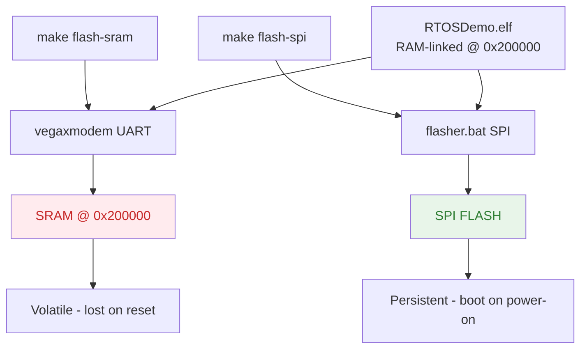

# Flash Workflow

---
tags: [flash, workflow, deployment]
status: active
created: 2026-11-01
---

# Flash Workflow

> How to flash firmware to the THEJAS32 board using vegaxmodem (SRAM) or flasher.bat (SPI FLASH).

## Two Flash Methods

| Tool | Destination | Persistence | Use Case |
|------|-------------|-------------|----------|
| `vegaxmodem` | SRAM @ `0x200000` | Volatile (lost on reset) | Quick dev iteration |
| `flasher.bat` | SPI FLASH | Persistent (boot on power-on) | Production deployment |

**Important:** Both flash the **same ELF file** (`RTOSDemo.elf` or `firmware.elf`), linked for RAM at `0x200000` per `riscv-thejas32.ld`. The difference is where it's stored:

- `vegaxmodem` loads directly into SRAM via UART bootloader
- `flasher.bat` writes to SPI FLASH; hardware bootloader copies SPI→SRAM on power-on

## Flow Diagram



## Build Commands

```bash
# Build firmware (links against vendor BSP objects)
make clean all
# Output: build/firmware.elf

# Flash to SRAM (volatile — for testing)
make flash-sram
# Runs: /home/siesta/flasher/vega-flasher/vegaxmodem /dev/ttyUSB0 build/firmware.elf

# Flash to SPI FLASH (persistent — for production)
make flash-spi
# Runs: /home/siesta/flasher/vega-flasher/flasher.bat build/firmware.bin

# Serial monitor
make monitor
# Runs: picocom --baud 115200 --flow n --echo /dev/ttyUSB0

# Memory usage
make size
```

## Linker Script Context

The existing `freertos-thejas32/Demo/RISCV_CDAC_THEJAS32/riscv-thejas32.ld` is a **RAM-only** linker script:

```ld
MEMORY {
    ram (rwx) : ORIGIN = 0x200000, LENGTH = 256k
}
ENTRY(_start)
```

This is designed for the `vegaxmodem` UART bootloader flow. For SPI flash production boot, you'll need a separate linker script with:

- `FLASH` memory region (e.g., `ORIGIN = 0x00000000`)
- `.text` in FLASH
- `.data` in RAM `AT > FLASH` (copy on boot)
- Vector table at `0x0`

## Navigation

- [[Developer Notes]] — Project overview and phases
- [[Architecture Details]] — Detailed layer specifications
- [[Makefile Evolution]] — How the Makefile grows across phases
- [[API Reference]] — All available headers and functions

All notes link back to [[_index.md]].
